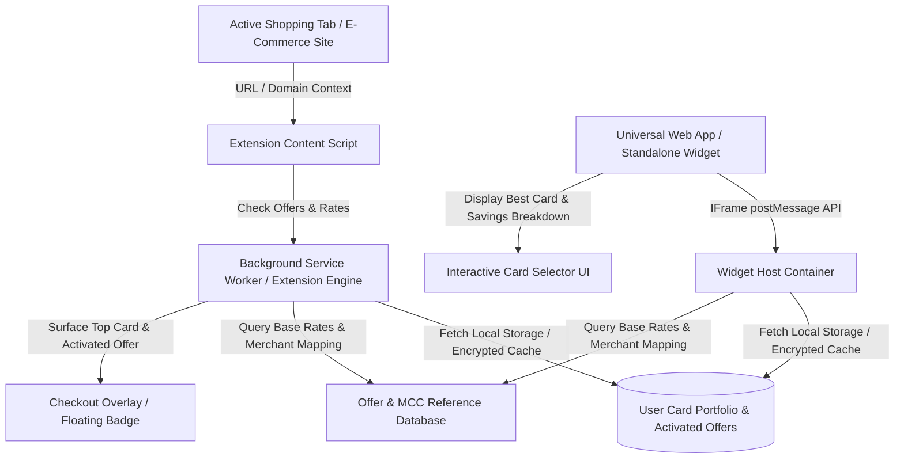

# US Credit & Debit Card Offer Recommender

A unified development reference and operational workflow for building a **US-focused Credit & Debit Card Offer Recommender**. This system consists of an embeddable multi-browser web widget and a Cross-Browser Extension (Chrome, Firefox, Edge, Safari) that automatically matches and recommends optimal payment cards, merchant-specific targeted offers, and rotating rewards at e-commerce checkout.

---

## 1. Project Overview & Core Requirements

### Primary Objectives
1. **Universal Web Widget**: A lightweight, responsive web app & embeddable iframe widget accessible from any modern browser (desktop and mobile) allowing users to search merchant offers, view card reward multipliers, and manage their card portfolio.
2. **Cross-Browser Extension (Manifest V3)**: Unobtrusive browser extension for Chrome, Firefox, Edge, and Safari that detects the active merchant, calculates maximum cash back / point yield across user-owned cards, and alerts users to activated targeted offers (e.g., Amex Offers, Chase Offers, BankAmeriDeals, Citi Merchant Offers, Capital One Shopping/Offers).
3. **Privacy-First Architecture**: No storage or transmission of sensitive financial data (PANs, CVVs, credentials). Operations rely strictly on user-selected card product names (e.g., *Chase Sapphire Reserve*, *Amex Gold Card*, *Capital One SavorOne*).

---

## 2. Supported US Offer & Card Ecosystem

### Supported Card Issuers & Networks
- **Major Issuers**: American Express, Chase, Capital One, Citi, Discover, Bank of America, Wells Fargo, US Bank, Barclays, Synchrony.
- **Networks**: Visa, Mastercard, American Express, Discover.

### Offer Categories
1. **Targeted Merchant Offers**:
   - Amex Offers (e.g., "$25 off $100 at Dell", "5x points at Nike")
   - Chase Offers & BankAmeriDeals (e.g., "10% cash back at Starbucks")
   - Citi Merchant Offers & Capital One Offers
2. **Category Base Multipliers**:
   - Merchant Category Code (MCC) point multipliers (e.g., 4x Dining/Grocery, 3x Travel, 5x Gas).
3. **Rotating Quarterly Categories**:
   - Chase Freedom Flex 5% categories, Discover it 5% quarterly categories, Citi Custom Cash top spending category.
4. **Shopping Portals & Card-Linked Cash Back**:
   - Issuer portals (Capital One Shopping, Chase Ultimate Rewards Shopping).

---

## 3. System Architecture & Component Breakdown



### Component Details

| Component | Responsibility | Primary Tech Stack |
| :--- | :--- | :--- |
| **Cross-Browser Extension** | Manifest V3 background service worker, domain detection, extension popup, side panel, content script overlays. | HTML5, Vanilla JS / Web Components, WXT / Extension Manifest V3 standard |
| **Universal Web Widget** | Embeddable iframe modal & standalone responsive Web App for any browser/mobile view. | HTML5, Modern CSS (Glassmorphism design system), JavaScript |
| **Offer Matching Engine** | Calculates best card per transaction: Total Value = Base Multiplier Value + Targeted Offer Discount. | Pure JS utility module |
| **Data Synchronization** | Syncs user card list & activated offers between Web App and Extension locally or via user-controlled encrypted storage. | Browser Extension Storage API (`chrome.storage.local`), IndexedDB, Web Storage |

---

## 4. Key Workflows & Implementation Guidelines

### Workflow A: Merchant & Domain Detection (Extension Content Script)
- Extract normalized root domain from `window.location.hostname` (e.g., `checkout.nike.com` -> `nike.com`).
- Query local offer lookup table for active targeted offers matching the domain.
- Query Merchant Category Code (MCC) map for the merchant (e.g., `nike.com` -> Apparel / Shopping).

### Workflow B: Best Card Calculation Logic
```javascript
/**
 * Calculates the best card for a given merchant domain and transaction amount.
 * @param {string} domain - e.g., "starbucks.com"
 * @param {number} amount - Estimated transaction value in USD
 * @param {Array} userCards - Array of user-owned card objects
 * @returns {Object} Recommendation result with top card and earnings breakdown
 */
function calculateBestCard(domain, amount, userCards) {
  let bestCard = null;
  let maxTotalSavings = -1;

  for (const card of userCards) {
    // 1. Check for targeted merchant offers (e.g., $10 off $50 or 10% back)
    const targetedOffer = findActiveTargetedOffer(card.id, domain, amount);
    const offerSavings = targetedOffer ? calculateOfferValue(targetedOffer, amount) : 0;

    // 2. Calculate category multiplier yield (e.g., 3x points on Dining @ $0.015/pt)
    const baseMultiplier = getCategoryMultiplier(card.id, domain);
    const rewardsValue = amount * baseMultiplier.rate * baseMultiplier.pointValuation;

    const totalValue = offerSavings + rewardsValue;

    if (totalValue > maxTotalSavings) {
      maxTotalSavings = totalValue;
      bestCard = {
        cardName: card.name,
        issuer: card.issuer,
        targetedOffer,
        baseMultiplier,
        totalEstimatedSavingsUSD: totalValue
      };
    }
  }

  return bestCard;
}
```

### Workflow C: Universal Web Widget Integration
To embed the widget on any website or third-party web application:

```html
<!-- Embeddable Offer Recommender Widget -->
<iframe 
  id="offer-recommender-widget"
  src="https://your-domain.com/widget.html?domain=amazon.com"
  style="width: 360px; height: 480px; border: none; border-radius: 16px; box-shadow: 0 20px 40px rgba(0,0,0,0.3);"
  loading="lazy"
></iframe>
```

Using `postMessage` for cross-domain security:
```javascript
// Listener inside host web app
window.addEventListener('message', (event) => {
  if (event.origin !== 'https://your-domain.com') return;
  if (event.data.type === 'CARD_SELECTED') {
    console.log('User selected card:', event.data.cardName);
  }
});
```

---

## 5. Manifest V3 Browser Extension Specifications

### Cross-Browser `manifest.json` Structure
```json
{
  "manifest_version": 3,
  "name": "US Credit & Debit Card Offer Recommender",
  "version": "1.0.0",
  "description": "Find the best card and activated targeted offers automatically at checkout.",
  "icons": {
    "16": "icons/icon16.png",
    "48": "icons/icon48.png",
    "128": "icons/icon128.png"
  },
  "action": {
    "default_popup": "popup.html",
    "default_icon": "icons/icon48.png"
  },
  "background": {
    "service_worker": "background.js",
    "scripts": ["background.js"]
  },
  "permissions": [
    "storage",
    "activeTab"
  ],
  "host_permissions": [
    "https://*/*"
  ],
  "content_scripts": [
    {
      "matches": ["https://*/*"],
      "js": ["content.js"],
      "css": ["content.css"],
      "run_at": "document_idle"
    }
  ],
  "side_panel": {
    "default_path": "sidepanel.html"
  }
}
```

> **Cross-Browser Note**: Firefox MV3 uses `"background": { "scripts": ["background.js"] }` while Chrome/Edge use `"service_worker": "background.js"`. Use build tooling (like WXT, Vite, or webextension-polyfill) to generate target-specific distribution archives.

---

## 6. Design System & Aesthetics Guidelines

- **Palette**: Sleek dark mode with premium metallic & vibrant jewel tones reflecting credit card tiers (Titanium `#E5E4E2`, Amex Gold `#D4AF37`, Sapphire `#0F52BA`, Emerald `#50C878`).
- **Typography**: Clean modern sans-serif (Inter, Outfit, or system-ui fallback).
- **Glassmorphism**: Backdrop blur (`backdrop-filter: blur(12px)`), subtle translucent borders (`border: 1px solid rgba(255, 255, 255, 0.1)`).
- **Micro-Interactions**: Smooth hover elevations, card-flip preview animations, subtle pulse indicators when targeted offers are matched at checkout.

---

## 7. Security, Privacy & Compliance Standards

1. **Zero Financial Data Collection**: Never request card numbers, expiration dates, or bank logins.
2. **Local Storage First**: Store user selected card portfolios in `chrome.storage.local` or browser `localStorage`.
3. **No Unnecessary Permissions**: Avoid requesting full web request interception or intrusive cookies unless explicitly required for affiliate offer verification.
4. **Transparent Disclosures**: Provide clear user disclosures regarding point valuations (e.g., Amex Membership Rewards @ 1.5c/pt, Chase Ultimate Rewards @ 1.5c/pt, Cash Back @ 1.0c/pt).

---

## 8. Verification & Development Checklist

- [ ] **Data Model Verified**: Pre-populate database with popular US cards (Amex Gold/Platinum, Chase Sapphire/Freedom, Capital One Venture X/Savor, Citi Double Cash/Custom Cash, Discover it).
- [ ] **Domain Matching Test**: Verify accurate domain mapping for top US retailers (Amazon, Walmart, Target, Home Depot, Best Buy, Starbucks, Uber, etc.).
- [ ] **Extension Build Verification**: Test MV3 build on Chrome, Firefox (Developer Edition), Edge, and Safari Web Extension Converter.
- [ ] **Widget Responsive Test**: Verify iframe widget responsiveness down to 320px screen width and seamless `postMessage` event propagation.
